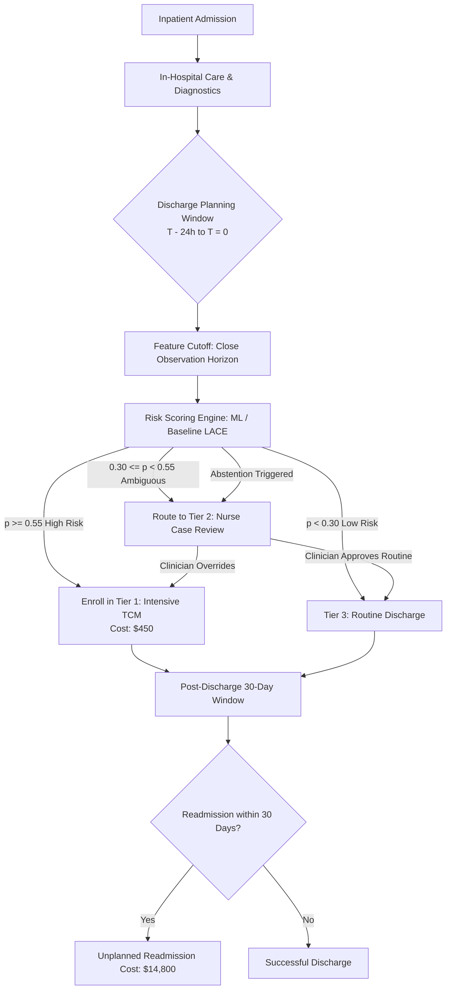

# Strategic Machine Learning Problem Framing Memo

**Document Version:** 1.0.0  
**Date:** September 19, 2026  
**Status:** Approved for Baseline Governance & Data Card Architecture  
**Target Domain:** Post-Discharge Transitional Care Management (TCM) & 30-Day Readmission Prevention  
**Authors:** Senior ML Engineer & Clinical AI Governance Committee  

---

## Executive Summary

Hospital readmissions within 30 days of discharge represent both a severe patient health hazard and a major economic penalty under the Centers for Medicare & Medicaid Services (CMS) Hospital Readmissions Reduction Program (HRRP). High-touch interventions—such as dedicated transitional care nurse visits, pharmacist-led medication reconciliation, and remote biometric monitoring—demonstrably cut readmission rates. However, clinical staff and telemonitoring resources are strictly constrained: a typical 500-bed hospital can enroll at most 15% to 20% of discharged patients into high-touch Transitional Care Management (TCM).

This memo formulates the predictive problem, establishes an objective scorecard to justify whether Machine Learning is warranted over deterministic clinical rules, defines temporal boundaries to eliminate data leakage, and models an asymmetric cost-utility framework ($C_{FP} = \$450$ vs. $C_{FN} = \$14,800$) to dictate operational decision thresholds.

---

## 1. Decision & Operational Context

### 1.1 The Operational Decision
* **Decision Statement:** For each adult patient scheduled for discharge from an inpatient ward, decide whether to assign the patient to:
  1. **Tier 1 (Intensive TCM Intervention):** Post-discharge home nurse visit within 48 hours, pharmacist medication review, 30-day cellular vitals monitoring kit, and prioritized clinic follow-up within 7 days. (Operational cost: **$450/patient**).
  2. **Tier 2 (Nurse Review / Triage Queue):** Clinician review for borderline or ambiguous cases before deciding allocation.
  3. **Tier 3 (Standard Discharge Protocol):** Standard printed discharge summary, patient education sheet, and routine primary care follow-up within 3 to 4 weeks. (Operational cost: **$0 marginal cost**).

* **Decision Maker:** Clinical Nurse Case Manager in consultation with the Attending Hospitalist at the multidisciplinary discharge huddle.
* **Capacity Constraint:** The TCM team can onboard a maximum of **35 new patients per week** (~15% of the average weekly discharge volume).

---

## 2. "Should We Use ML?" Justification Matrix

Before writing model code, we evaluate whether machine learning is genuinely required, or if deterministic rules or non-ML baselines suffice.

| Evaluation Dimension | Heuristic / Rule-Based System | Clinical Risk Score (LACE Index) | Supervised Machine Learning | Decision Rationale for ML |
| :--- | :--- | :--- | :--- | :--- |
| **Input Dimensionality** | Low (1–3 conditions, e.g., "Age > 70 AND COPD") | Low (4 additive variables) | High (35+ demographic, clinical, lab trajectory, social determinant features) | High non-linear cross-interactions between lab changes, polypharmacy, and socio-demographics cannot be captured in simple sum-scores. |
| **Adaptability to Shift** | Static, requires manual rule tweaking | Fixed published point system (van Walraven et al., 2010) | Continuously auditable and retrainable with covariate drift tracking | Hospital demographics, seasonal disease waves (influenza/RSV), and staffing shift dynamically over time. |
| **Calibration & Probability Output** | Binary (Yes/No) or crude tiers | Integer score 0–19 (poorly calibrated across modern comorbidities) | Calibrated posterior probabilities $P(Y=1 \mid X)$ | Downstream cost optimization requires calibrated probabilities to compute expected monetary value per intervention. |
| **Maintenance Burden** | High rule-sprawl and frequent edge-case collisions | Zero code maintenance, but persistent clinical inaccuracy | Requires CI/CD pipeline, data cards, and drift monitoring | Justified only if marginal economic and health savings exceed MLOps maintenance costs (~$60k/yr). |
| **Risk of Unintended Bias** | Blind to demographic bias; often encodes human bias | Validated in Canadian population; exhibits known disparities across diverse urban cohorts | Can actively measure and constrain Equalized Odds and Disparate Impact | ML provides explicit mathematical mechanisms to audit and mitigate disparate impact. |

**Verdict:** Machine learning is **justified**, provided it is rigorously validated against the published non-ML **LACE clinical score baseline** and bounded by automated abstention and circuit-breaker rollbacks.

---

## 3. Mathematical Formulation of the Prediction Problem

### 3.1 Prediction Target ($Y$)
* **Formal Definition:**
  $$Y = \begin{cases} 1 & \text{if patient experiences an unplanned, all-cause inpatient readmission within 30 calendar days of discharge} \\ 0 & \text{otherwise} \end{cases}$$
* **Exclusions from Target ($Y=0$ or Dropped):**
  * Planned elective readmissions (e.g., scheduled chemotherapy, staged hip arthroplasty, planned cardiac catheterization).
  * In-hospital mortality during the index admission (competing risk).
  * Transfers to other acute care facilities or hospice care.
* **Label Delay & Censorship:**
  * Ground truth requires waiting **30 days post-discharge** plus a **3-day billing claim aggregation lag** ($T_{eval} = T_{discharge} + 33\text{ days}$).
  * Right-censoring occurs if the patient relocates or is admitted to an out-of-network hospital without health information exchange (HIE) data.

### 3.2 Unit of Observation
* **Unit:** A single **Inpatient Stay Encounter** uniquely identified by `(patient_id, encounter_id)`.
* **Critical Distinction:** The unit is **not** the patient. A single patient may have multiple admissions over several years.
* **Train/Test Independence Constraint:** To prevent target and entity leakage, **all encounters belonging to the same `patient_id` must reside strictly within the same data split (GroupKFold by `patient_id`)** or follow a strict chronological split where training strictly precedes test admissions.

---

## 4. Action Window & Temporal Feature Horizon

To prevent **temporal data leakage**, feature availability must be locked at the exact moment the clinical decision is executed.

```mermaid
gantt
    title Clinical Observation & Prediction Horizon
    dateFormat  X
    axisFormat %d d

    section Encounter
    Admission (T_admit)              :0, 1
    Inpatient Stay (LOS = 4 days)     :active, 1, 5
    Discharge Planning & Decision     :crit, 4, 5
    Discharge Event (T_discharge)     :5, 6

    section Feature Horizon
    Historical Claims & Prior ED     :done, 0, 4
    Vitals, Labs, Med Changes        :done, 1, 4
    FEATURE CUTOFF STRICT LOCKDOWN   :milestone, 4, 4

    section Post-Discharge
    TCM Intervention Delivery        :active, 5, 12
    30-Day Readmission Window        :crit, 5, 35
    Label Finalization (T_discharge+33):milestone, 38, 38
```

* **Observation Horizon ($T_{admit} \to T_{cutoff}$):** Data up to 24 hours prior to scheduled discharge.
* **Prediction Point ($T_{cutoff}$):** The morning of discharge planning (08:00 on the day of discharge).
* **Action Window:** TCM team is notified at $T_{cutoff}$; outreach begins at $T_{discharge}$; home visit occurs within 48 hours post-discharge ($T+2\text{ days}$).
* **Strictly Prohibited Features (Post-Cutoff):**
  * Any lab or vital sign recorded after $T_{cutoff}$.
  * Discharge summary notes signed after discharge.
  * Post-discharge outpatient pharmacy claims.
  * Outpatient clinic attendance data.

---

## 5. Non-ML Baseline Specification: The LACE Index

The primary comparative non-ML baseline is the established **LACE Index** (van Walraven et al., *CMAJ* 2010), calculated as:

$$\text{LACE Score} = \text{Score}_L + \text{Score}_A + \text{Score}_C + \text{Score}_E$$

Where:
1. **L (Length of Stay):** 0 pts ($<1$ day), 1 pt (1 day), 2 pts (2 days), 3 pts (3 days), 4 pts (4–6 days), 5 pts (7–13 days), 7 pts ($\ge 14$ days).
2. **A (Acuity of Admission):** 3 pts if emergency department admission; 0 pts if elective.
3. **C (Charlson Comorbidity Index):** 0 pts (score 0), 1 pt (score 1), 2 pts (score 2), 3 pts (score 3), 5 pts ($\ge 4$).
4. **E (Emergency Department visits in past 6 months):** 0 pts (0 visits), 1 pt (1 visit), 2 pts (2 visits), 3 pts (3 visits), 4 pts ($\ge 4$ visits).

* **Baseline Decision Rule:** If $\text{LACE Score} \ge 10$, classify as High Risk and flag for TCM intervention.

---

## 6. Asymmetric Cost-Benefit Framework & Objective Metric

In clinical resource allocation, errors have drastically asymmetric consequences. Evaluating models solely by raw Accuracy or symmetric F1-score is financially and clinically unsound.

### 6.1 Cost Matrix Formulation

| Reality \ Prediction | Predicted Positive (Intervene / TCM) | Predicted Negative (Routine Discharge) |
| :--- | :--- | :--- |
| **Actual Readmitted ($Y=1$)** | **True Positive (TP)** Cost = $C_{TCM} + (1 - \text{Eff}) \times C_{Readmit}$ $= \$450 + (1 - 0.35) \times \$14,800 = \mathbf{\$5,630}$ | **False Negative (FN)** Cost = $C_{Readmit}$ $= \mathbf{\$14,800}$ (Missed patient readmits) |
| **Actual Not Readmitted ($Y=0$)** | **False Positive (FP)** Cost = $C_{TCM} = \mathbf{\$450}$ (Wasted nurse outreach & monitor kit) | **True Negative (TN)** Cost = $\mathbf{\$0}$ (Routine discharge, no intervention) |

* **Assumptions:**
  * $C_{Readmit} = \$14,800$ (Average uncompensated hospital stay cost + CMS HRRP penalty burden per excess readmission).
  * $C_{TCM} = \$450$ (Nurse time, remote monitoring hardware amortized, pharmacist consult).
  * Intervention Efficacy ($\text{Eff}$): High-touch TCM prevents **35%** of readmissions in enrolled patients (established in clinical trials by Naylor et al. and Coleman et al.).
  * Opportunity Cost / Harm of False Positive: Low clinical risk, minor inconvenience, but exhausts limited nurse capacity.
  * Penalty of False Negative: **$14,800** direct financial cost + preventable clinical deterioration.

### 6.2 Net Benefit and Optimal Probability Threshold ($\tau^*$)

The expected financial loss function $\mathcal{L}(\tau)$ across $N$ validation patients is:

$$\mathcal{L}(\tau) = \sum_{i=1}^N \left( \text{FP}_i(\tau) \times \$450 + \text{FN}_i(\tau) \times \$14,800 + \text{TP}_i(\tau) \times \$5,630 \right)$$

The theoretical Bayes-optimal decision threshold $\tau^*$ that minimizes expected cost (assuming perfect intervention efficacy) is:

$$\tau^* = \frac{C_{FP}}{C_{FP} + C_{FN}} = \frac{450}{450 + 14,800} = \frac{450}{15,250} \approx \mathbf{0.0295}$$

Adjusting for realistic 35% intervention efficacy ($\Delta C_{TP} = 0.35 \times \$14,800 - \$450 = \$4,730$ net savings per true readmission caught):

$$\tau^*_{\text{operational}} = \frac{C_{FP}}{\Delta C_{TP} + C_{FP}} = \frac{450}{4,730 + 450} \approx \mathbf{0.0869}$$

* **Primary Optimization Metric:** **Expected Monetary Value (EMV) / Total Hospital Net Cost**, supported by **PR-AUC (Precision-Recall Area Under Curve)** and **Recall at Capacity (Recall@K = 15%)**.

---

## 7. Operational Guardrails: Abstention, Review & Rollback

### 7.1 Three-Tier Decision Routing
1. **Automated Recommendation Tier ($\hat{p} \ge 0.40$):** High confidence of readmission risk. Directly flags patient on the case manager's electronic discharge dashboard.
2. **Human-in-the-Loop Triage Tier ($0.15 \le \hat{p} < 0.40$ or Abstention Flag):** Indeterminate confidence band or moderate risk with complex comorbidities. Case manager evaluates social support and clinical stability during the morning huddle.
3. **Routine Care Tier ($\hat{p} < 0.15$):** Low risk; standard discharge instructions.

### 7.2 Hard Abstention Triggers
The model must refuse to predict and immediately route the patient to human clinical judgment when:
1. **Critical Feature Missingness:** More than 30% of vital signs or lab features are absent during the index stay.
2. **Out-of-Distribution (OOD) Diagnosis:** Patient primary ICD-10 code represents a rare disease category with $<10$ historical instances in the training corpus.
3. **High Prediction Epistemic Uncertainty:** Ensemble variance or prediction entropy exceeds the 95th percentile of historical validation data.

### 7.3 Monitoring & Automated Rollback Triggers
* **Population Stability Index (PSI):** Calculated weekly on input feature distributions.
  * $PSI < 0.10$: Stable.
  * $0.10 \le PSI < 0.25$: Warning; trigger manual audit.
  * $PSI \ge 0.25$: **Critical Drift — Trip automated circuit breaker.**
* **Disparate Impact Ratio (DIR):** Selection rate ratio across race and age cohorts.
  * If $\min_g (\text{SelectionRate}_g / \text{SelectionRate}_{\text{majority}}) < 0.80$, trip circuit breaker.
* **Rollback Action:** Upon circuit breaker activation, the inference pipeline automatically reverts 100% of patient scoring to the **Non-ML LACE Index Scorecard**, dispatches high-priority PagerDuty alerts to MLOps and the Clinical AI Committee, and suspends model scoring until root-cause analysis is signed off.

---

## Sign-off & Next Steps
This problem framing establishes the operational envelope for the dataset construction, responsible data card auditing, baseline modeling notebook, and risk register.
