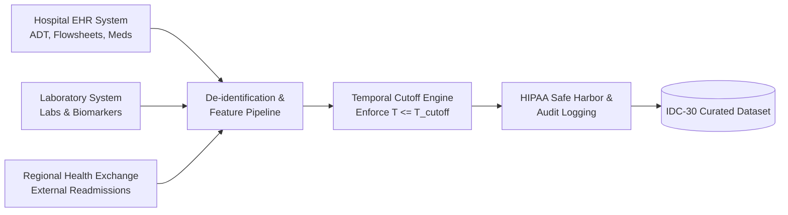
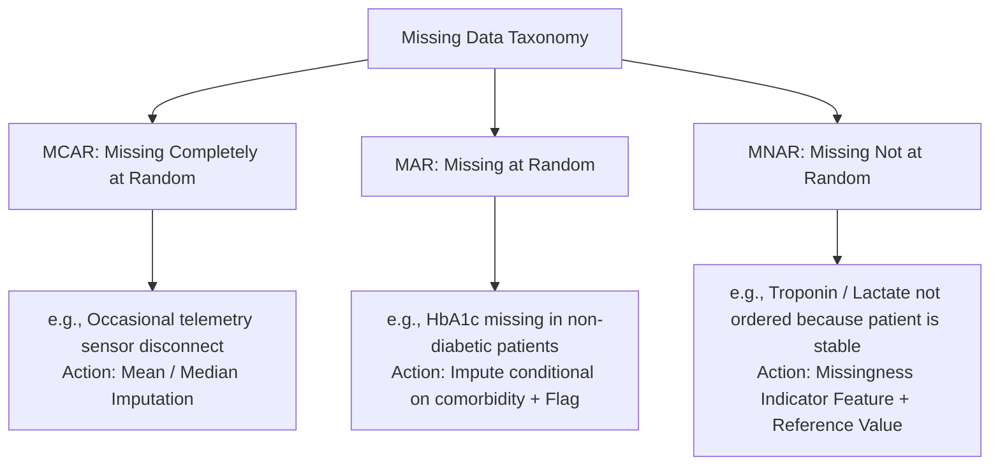

# Responsible AI Data Card: Inpatient Discharge Cohort (IDC-30)

**Dataset Name:** Inpatient Discharge Cohort for Readmission Risk (IDC-30)  
**Schema Version:** 2.1.0  
**Domain:** Inpatient Electronic Health Records (EHR) & Claims Data  
**Lead Curators:** Healthcare Analytics Consortium & Responsible AI Governance Board  
**Target Use Case:** Post-Discharge Transitional Care Management (TCM) Allocation  

---

## 1. Dataset Overview & Intended Use

### 1.1 Summary
The **Inpatient Discharge Cohort (IDC-30)** is a curated multimodal electronic health record (EHR) dataset capturing adult inpatient admissions across acute-care medical and surgical wards. Each record models an acute inpatient encounter up to the moment of discharge planning ($T_{cutoff}$), paired with a 30-day post-discharge readmission outcome label.

### 1.2 Intended Purpose & Scenarios
* **Primary Intended Use:** Stratifying adult inpatient discharge encounters into risk tiers to assist nurse case managers in allocating post-discharge transitional care resources (home visits, medication reconciliation, telemonitoring kits).
* **Target Users:** Licensed hospital case managers, discharge coordinators, and attending physicians within multidisciplinary discharge rounds.
* **Operational Mode:** **Decision-support (human-in-the-loop).** The system provides probability estimates and feature attributions; clinical staff retain ultimate discretion.

### 1.3 Out-of-Scope & Prohibited Uses
* ❌ **Prohibited: Fully Autonomous Discharge or Intervention Denials:** The model must never autonomously deny care, cancel follow-ups, or accelerate discharge without human review.
* ❌ **Prohibited: Emergency Department Triage or ICU Prioritization:** This dataset reflects floor-inpatient trajectories; applying it to ED triage or intensive care bed rationing is medically invalid.
* ❌ **Prohibited: Commercial Insurance Denials or Premium Adjustments:** Use for underwriting, insurance reimbursement caps, or benefit determinations is strictly prohibited under institutional data agreements.
* ❌ **Prohibited: Pediatric Populations (<18 years old):** Pediatric physiology and readmission drivers (parental compliance, specialized pediatric conditions) differ fundamentally from adult cohorts.
* ❌ **Prohibited: Obstetric and Psychiatric Primary Admissions:** Specialized pathways govern these admissions with distinct readmission dynamics.

---

## 2. Provenance, Collection & Legal Governance

### 2.1 Data Sources & Extraction Architecture
* **Primary Systems:**
  1. **EHR Core (Epic/Cerner):** Admission-Discharge-Transfer (ADT) events, nursing flowsheets, vital signs, medication administration records (MAR), and diagnostic codes.
  2. **Laboratory Information System (LIS):** Serial serum chemistries, complete blood counts, cardiac enzymes, and microbiology reports.
  3. **Enterprise Master Patient Index (EMPI):** Deterministic and probabilistic linking of patient identities across hospital facilities.
  4. **Regional Health Information Exchange (HIE):** Captures out-of-system 30-day readmissions across affiliated regional hospital networks to minimize right-censoring.

### 2.2 Patient Consent & Legal Framework
* **Regulatory Compliance:** Governed under the **Health Insurance Portability and Accountability Act (HIPAA)** 45 CFR § 164.514(b) and the **Common Rule** (45 CFR part 46).
* **De-Identification Protocol:** Curated using the **HIPAA Safe Harbor** method:
  * All 18 direct HIPAA identifiers (names, Social Security numbers, medical record numbers, phone numbers, email addresses, device identifiers, and exact street addresses) are stripped.
  * Dates are jittered by a uniform random patient-level offset $\Delta \in [-14, +14]\text{ days}$ preserving seasonal and interval relationships.
  * Geographic data aggregated to 3-digit ZIP codes with populations $> 20,000$.
  * Ages $>89$ aggregated into a single categorical bin `90+` to prevent re-identification.
* **Institutional Review Board (IRB):** Deemed exempt under 45 CFR 46.104(d)(4) (Secondary research on de-identified health data) by the Clinical Research Ethics Board (IRB #2024-HAP-0881).
* **Patient Notice:** General Notice of Privacy Practices informs patients that de-identified operational data is utilized for clinical quality improvement and predictive analytics.

---

## 3. Cohort Demographics, Sensitive Attributes & Proxy Risks

### 3.1 Protected & Sensitive Demographic Attributes

| Attribute | Field Name | Representation | Rationale & Protection Status |
| :--- | :--- | :--- | :--- |
| **Age** | `age_years` | Continuous (18–89, 90+) | Protected under Age Discrimination Act. Elderly patients have higher biological vulnerability and social isolation. |
| **Biological Sex** | `sex` | Categorical (`Female`, `Male`) | Clinical pharmacology and symptom presentation vary; audited for equalized odds. |
| **Race & Ethnicity** | `race_ethnicity` | Categorical (`White`, `Black/African American`, `Hispanic/Latino`, `Asian`, `Other/Multiracial`) | Title VI Civil Rights Act. Historical systemic inequities in healthcare access must not be compounded. |
| **Insurance Status** | `insurance_payer` | Categorical (`Medicare`, `Medicaid`, `Commercial`, `Uninsured`) | Strong socioeconomic indicator. Risk of encoding socioeconomic penalization. |
| **Housing Stability** | `housing_unstable` | Binary ($0/1$) derived from ICD-10 Z59 codes | Social Determinant of Health (SDOH). Critical for discharge safety, high risk of stigmatization. |

### 3.2 Proxy Variable & Bias Analysis
Direct exclusion of sensitive attributes (e.g., removing `race_ethnicity`) is insufficient to prevent algorithmic bias due to correlated proxy variables:

* **Socioeconomic Proxy (ZIP Code & Insurance):** Neighborhood-level Area Deprivation Index (ADI) and Medicaid payer status correlate strongly with racial minority status due to historic redlining. If unmonitored, the model might learn that Medicaid patients are "higher risk" solely due to delayed primary care access rather than intrinsic clinical instability.
* **Utilization as Proxy for Sickness:** Prior Emergency Department visits (`prior_ed_visits_6m`) reflects not only health acuity but also lack of primary care access. Uninsured or marginalized patients utilize the ED for routine prescription refills, causing the model to overestimate acute readmission risk or create disparate impact in triage queues.
* **Mitigation Protocol:** 
  1. No feature shall be included whose sole predictive power is driven by race or socioeconomic marginalization without clinical rationale.
  2. Model outputs must be evaluated against **Demographic Parity** and **Equal Opportunity** across racial and payer slices prior to deployment.

---

## 4. Missingness Mechanisms & Clinical Semantics

In clinical data, **missingness is rarely random**. The fact that a lab test was *not* ordered is often an active clinical signal that the physician considered the patient stable.

### 4.1 Detailed Breakdown by Feature Category

| Feature Name | Typical Missingness | Mechanism | Clinical Semantic / Root Cause | Preprocessing & Imputation Rule |
| :--- | :--- | :--- | :--- | :--- |
| `systolic_bp`, `heart_rate` | $< 2\%$ | **MCAR** | Sensor artifact, transient disconnect during patient ambulation. | Median imputation using index admission vitals. |
| `hba1c_level` | $48\%$ | **MAR** | Only ordered for patients with documented diabetes or acute hyperglycemia. | Add binary indicator `hba1c_missing = 1`; impute missing value with non-diabetic reference mean (5.4%). |
| `serum_creatinine` | $5\%$ | **MAR** | Standard metabolic panel ordered for nearly all acute admissions; omitted in minor surgical stays. | Impute normal baseline (0.9 mg/dL) + add `creatinine_missing` indicator. |
| `pain_score_avg` | $18\%$ | **MNAR** | Patients experiencing severe pain have frequent scores recorded; pain-free or resting patients have fewer entries. | Impute zero pain (0.0) + missing indicator feature. |
| `social_support_score` | $35\%$ | **MNAR** | Case management social assessments are prioritized for elderly or visibly struggling patients. | Retain as explicit category `Unknown/Unassessed`; trigger nurse review if high clinical risk. |

> [!IMPORTANT]
> **Zero-Imputation Fallacy**: Imputing zeros for missing lab values without clinical grounding (e.g., setting missing serum potassium to 0) creates lethal physiological contradictions. All imputations must employ physiologically normal reference points paired with explicit **missingness indicator flags** ($I_{\text{missing}} \in \{0, 1\}$).

---

## 5. Data Leakage Audit & Prevention Protocols

Data leakage is the single most common reason clinical ML models fail when deployed in production. We classify and mitigate three distinct leakage vectors:

### 5.1 Temporal Leakage (Looking into the Future)
* **Hazard:** Including information generated after the decision cutoff ($T_{cutoff}$).
* **Specific Leakage Scenarios & Mitigations:**
  * *Discharge Summary Notes:* Dictated and signed 24 to 72 hours *after* the patient has left the hospital. If NLP features extract mentions like *"readmission risk discussed"* or *"transferred to rehab"*, the model cheats.
    * **Audit Rule:** NLP features are restricted strictly to progress notes authored before $T_{cutoff}$ (08:00 on discharge day).
  * *Post-Discharge Labs:* Outpatient lab orders drawn 3 days post-discharge inadvertently merged into the inpatient encounter.
    * **Audit Rule:** Automated SQL validation constraint: `assert all(event_timestamp <= discharge_planning_timestamp)`.

### 5.2 Target Leakage (Features Containing the Label)
* **Hazard:** Input features that implicitly encode whether the patient is about to be readmitted or cannot be readmitted.
* **Specific Scenarios:**
  * *Discharge Disposition Code:* Dispositions like `Hospice / Expired` guarantee $Y=0$ (cannot be readmitted), while `Discharged Against Medical Advice (AMA)` has an artificially high readmission rate.
    * **Audit Rule:** Patients with in-hospital mortality or hospice are filtered out during cohort creation. AMA is isolated into a separate clinical protocol.
  * *Post-Discharge Appointment Scheduling Flags:* If a follow-up visit is scheduled at day 29, does it encode planned treatment?
    * **Audit Rule:** Planned admissions are strictly filtered out of the target definition.

### 5.3 Entity / Patient Overlap Leakage (Train-Test Contamination)
* **Hazard:** Splitting data purely at the row/encounter level when individual patients have multiple hospital stays.
* **Mechanism:** Patient A is admitted in January and readmitted in March. If January is in Train and March is in Test, the model memorizes Patient A's static physiological profile (e.g., baseline creatinine, chronic conditions) rather than learning generalized risk signals.
* **Mandatory Architecture:** 
  $$\text{Train} \cap \text{Test} = \emptyset \quad \text{on } \texttt{patient\_id}$$
  Data splitting **MUST** utilize `GroupKFold(groups=patient_id)` or a **Strict Chronological Cutoff** (e.g., Train on Admissions 2023–2024, Test on Admissions 2025–2026).

---

## 6. Dataset Schema & Feature Dictionary

The curated dataset contains 5,000 encounters with 22 features categorized into four functional groups:

| Column Name | Data Type | Physical Unit / Range | Category | Description |
| :--- | :--- | :--- | :--- | :--- |
| `encounter_id` | String / UUID | Unique ID | Metadata | Unique identifier for the inpatient stay |
| `patient_id` | String / UUID | Unique ID | Metadata | Unique patient identifier (used for group splitting) |
| `admission_date` | Timestamp | YYYY-MM-DD | Temporal | Inpatient admission timestamp |
| `discharge_date` | Timestamp | YYYY-MM-DD | Temporal | Discharge timestamp ($T_0$) |
| `age_years` | Float | 18.0 – 95.0 | Demographic / Sensitive | Patient chronological age |
| `sex` | Categorical | `Female`, `Male` | Demographic / Sensitive | Biological sex recorded at admission |
| `race_ethnicity` | Categorical | 5 categories | Demographic / Sensitive | Self-reported racial and ethnic category |
| `insurance_payer` | Categorical | 4 categories | Socioeconomic / Sensitive | Primary insurance coverage payer |
| `length_of_stay_days` | Float | 1.0 – 35.0 days | Clinical Trajectory | Total inpatient length of stay up to discharge |
| `admission_acuity_emergency` | Binary | $0$ (Elective), $1$ (Emergency) | Clinical Acuity | Admitted through the Emergency Department |
| `charlson_comorbidity_index` | Integer | 0 – 14 | Comorbidity | Weighted sum of chronic conditions (CCI) |
| `prior_inpatient_admissions_12m`| Integer | 0 – 15 | Healthcare Utilization | Number of inpatient admissions in previous 12 months |
| `prior_ed_visits_6m` | Integer | 0 – 20 | Healthcare Utilization | ED visits in past 6 months (LACE component) |
| `num_medications_prescribed` | Integer | 1 – 42 | Polypharmacy | Active medications on discharge order |
| `high_risk_medication_flag` | Binary | $0$ or $1$ | Polypharmacy | Prescription of anticoagulants, insulin, or opioids |
| `serum_creatinine_last` | Float | 0.4 – 8.5 mg/dL | Lab / Physiological | Last renal function lab prior to $T_{cutoff}$ |
| `creatinine_missing` | Binary | $0$ or $1$ | Missingness Indicator | Explicit flag for missing creatinine |
| `hemoglobin_last` | Float | 5.5 – 18.0 g/dL | Lab / Physiological | Last complete blood count hemoglobin |
| `systolic_bp_last` | Float | 75 – 220 mmHg | Vital Signs | Last recorded systolic blood pressure |
| `sodium_last` | Float | 115 – 155 mEq/L | Lab / Physiological | Serum sodium level |
| `lace_index_score` | Integer | 0 – 19 | Baseline Risk Score | Computed clinical LACE Index score |
| `readmitted_30d` | Binary | $0$ (No), $1$ (Yes) | **Prediction Target** | Unplanned 30-day all-cause readmission |

---

## 7. Maintenance & Continuous Quality Auditing

1. **Schema Validation:** Automated pipeline assertions verify data ranges, missingness bounds, and type consistency on each ETL run.
2. **Fairness Drift Alarms:** Demographic Parity Disparity and Selection Rate Ratios are recalculated weekly.
3. **Sunset Criteria:** Dataset retires when hospital clinical pathways undergo major structural reorganizations or every 18 months, triggering re-curation and re-validation.
