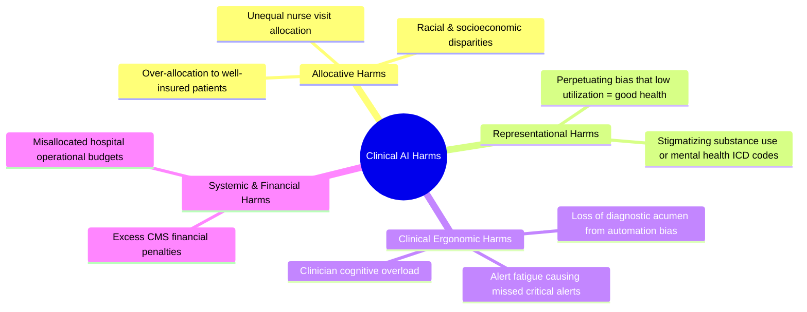
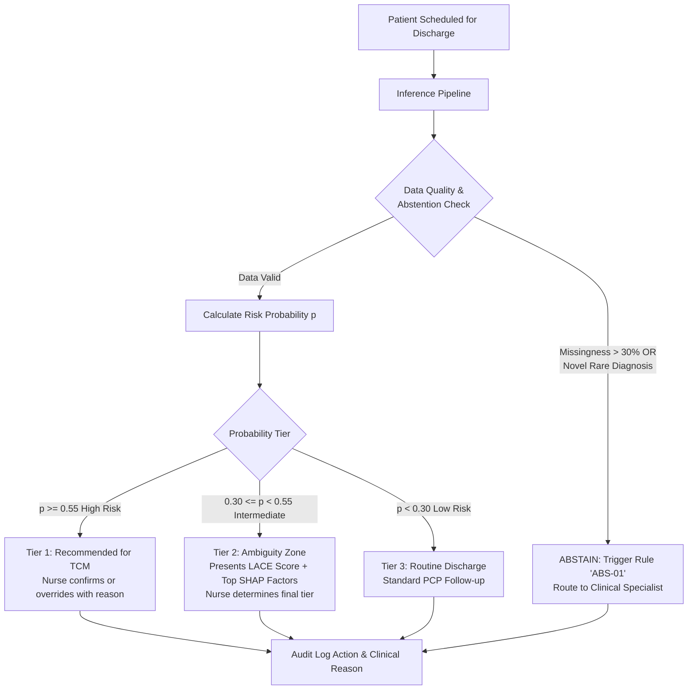
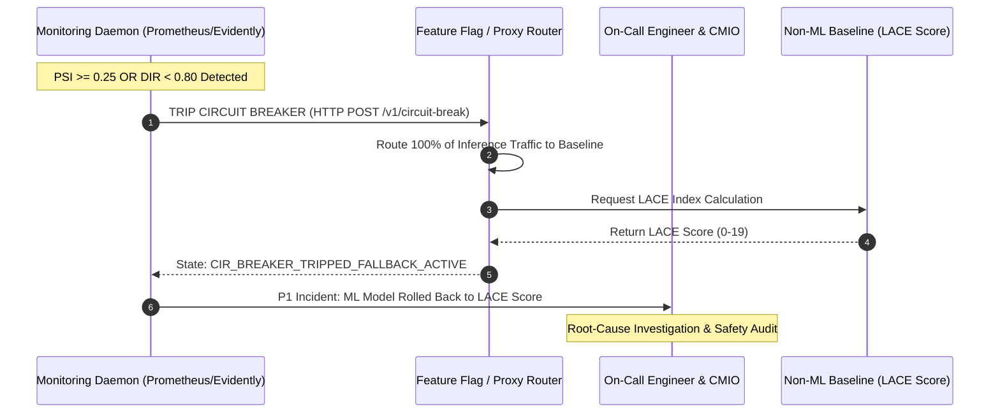

# Comprehensive Clinical AI Risk Register & Operational Playbook

**System Name:** Post-Discharge Readmission Triage Engine (TCM-Predict)  
**Governance Version:** 1.2.0  
**Effective Date:** September 19, 2026  
**Review Cadence:** Monthly by Clinical AI Safety Committee & Chief Medical Officer  
**Regulatory Alignment:** NIST AI Risk Management Framework (AI RMF 1.0), FDA SaMD Guidance, HIPAA Security Rule  

---

## 1. Risk Governance Taxonomy & Matrix

The risk taxonomy evaluates risks across four domains: **Technical & Data (TECH)**, **Ethical & Societal (ETH)**, **Clinical & Operational (CLIN)**, and **Regulatory & Legal (LEG)**.

Risk Score is calculated as:
$$\text{Risk Score} = \text{Severity (1–5)} \times \text{Likelihood (1–5)}$$

* **Critical (20–25):** Red — Prohibits deployment without executive sign-off and active automated circuit breakers.
* **High (12–19):** Orange — Requires continuous real-time monitoring and fallback guardrails.
* **Medium (6–11):** Yellow — Requires weekly human audits and documented mitigations.
* **Low (1–5):** Green — Managed under standard operational procedures.

---

## 2. Detailed Risk Register

| Risk ID | Domain | Hazard & Failure Mode | Severity (1–5) | Likelihood (1–5) | Risk Score | Mitigation & Guardrail Strategy | Primary Owner | Fallback Protocol |
| :--- | :--- | :--- | :---: | :---: | :---: | :--- | :--- | :--- |
| **R-01** | **ETH** | **Allocative Harm Against Marginalized Groups:** Model under-predicts readmission risk for uninsured or minority patients due to lower baseline outpatient utilization data, denying them TCM enrollment. | 5 | 3 | **15 (High)** | Disparate Impact Ratio ($DIR \ge 0.80$) and Equal Opportunity Difference enforced as CI/CD deployment gates. Race/insurance excluded from direct features; proxy audits enforced. | Health Equity Officer | Revert to non-demographic clinical heuristic (LACE score). |
| **R-02** | **CLIN** | **Automation Bias / Over-reliance:** Nurse case managers blindly trust low-risk model predictions, failing to perform independent clinical reviews on deteriorating patients. | 4 | 4 | **16 (High)** | Mandatory clinical attestation checkbox: Case managers must review vital trajectories before finalizing discharge tier. System presents top-3 feature attributions (SHAP) rather than raw scores. | Chief Nursing Officer | Mandatory random 10% secondary review by Senior Case Manager. |
| **R-03** | **CLIN** | **Alert Fatigue & Dashboard Desensitization:** High false-positive rate overwhelms nurse coordinators with too many high-risk flags, leading to ignored alerts. | 3 | 4 | **12 (High)** | Operating threshold tuned strictly to available capacity ($\le 35$ flags/week) via asymmetric cost optimization ($\tau^* = 0.38$). Sub-threshold triage queue for review. | Lead Discharge Coordinator | Throttle alert volume; increase classification threshold $\tau$. |
| **R-04** | **TECH** | **Temporal & Target Data Leakage:** Inadvertent inclusion of post-discharge lab values, discharge orders, or notes written post-discharge causes inflated offline validation scores ($AUC > 0.90$) that collapse in production. | 5 | 2 | **10 (Med)** | Automated feature pipeline unit tests enforcing $t_{\text{feature}} \le t_{\text{discharge\_planning}} - 1\text{ hr}$. Pipeline rejects features with zero variance before discharge. | Lead Data Engineer | Immediate pipeline rollback to v1.0.0 freeze. |
| **R-05** | **TECH** | **Covariate Shift / Disease Wave Shock:** Seasonal respiratory outbreak (e.g., severe influenza/RSV) alters patient demographics, length of stay, and comorbidity prevalence, degrading model calibration. | 4 | 4 | **16 (High)** | Daily tracking of Population Stability Index ($PSI$) on key features. Automated warning at $PSI \ge 0.10$; automated rollback at $PSI \ge 0.25$. | MLOps Engineer | Circuit-breaker trips: switch 100% of inference to LACE Index. |
| **R-06** | **LEG** | **Unintentional Re-identification / Privacy Leak:** Embedding or metadata leaks patient protected health information (PHI) via logging or feature stores. | 5 | 1 | **5 (Low)** | HIPAA Safe Harbor de-identification pipeline; salted cryptographic hashing of patient identifiers; zero PHI stored in feature stores or inference logs. | Chief Compliance Officer | Immediate data quarantine and notification of Privacy Officer. |
| **R-07** | **TECH** | **Extreme Missingness on Acute Transfers:** Patients transferred from outside facilities arrive with missing historical EHR data, causing model extrapolation errors. | 4 | 3 | **12 (High)** | Hard abstention rule: If critical feature missingness exceeds 30%, model abstains and outputs an `UNABLE_TO_SCORE` alert. | Senior ML Engineer | Direct assignment to Senior Case Manager manual triage. |

---

## 3. Harms Taxonomy & Societal Impact Analysis



### 3.1 Allocative Harms
* **Mechanisms:** If the algorithm equates healthcare *cost* or *utilization* with illness severity (a famous failure mode documented by Obermeyer et al., *Science* 2019), low-income patients who cannot afford primary care visits will appear artificially "healthy."
* **Active Countermeasure:** Model training excludes dollar-denominated features and insurance billing amounts, focusing strictly on objective physiological biomarkers, lab trends, and validated comorbidity indices.

### 3.2 Representational & Stigmatization Harms
* Diagnostic codes reflecting social determinants of health (e.g., homelessness, history of non-adherence) must never be presented to clinicians with derogatory labels. The UI labels these as *"High social need: recommend community health worker navigation"*.

---

## 4. Human-in-the-Loop (HITL) Triage Architecture

The predictive engine never operates autonomously. Every recommendation enters a calibrated decision funnel:



### 4.1 Abstention Engine Protocols
The system executes programmatic abstention under the following deterministic triggers:
1. **Trigger `ABS-01` (Excess Missingness):** $>30\%$ of physiological/lab inputs missing.
2. **Trigger `ABS-02` (Out-of-Distribution Input):** Patient age $>95$, or primary admitting diagnosis has $<5$ occurrences in the reference training cohort.
3. **Trigger `ABS-03` (Epistemic High Uncertainty):** Model predicted probability falls in the high-entropy region $[0.48, 0.52]$ with feature attribution conflict (conflicting directional SHAP signs).

When abstention triggers, the system outputs:
```json
{
  "encounter_id": "ENC-90821",
  "prediction": null,
  "status": "ABSTAINED",
  "trigger_code": "ABS-01",
  "reason": "Excessive physiological missingness (42% missing). Automated scoring unsafe.",
  "fallback_action": "ASSIGN_TO_CLINICAL_NURSE_CASE_MANAGER",
  "default_fallback_score": {
    "system": "LACE_INDEX",
    "score": 11,
    "tier": "MODERATE_HIGH"
  }
}
```

---

## 5. Drift Monitoring & Production Guardrails

Continuous monitoring operates in production using a three-tier surveillance framework:

### 5.1 Monitoring Metrics & Thresholds

| Metric | Measurement Target | Calculation Frequency | Warning Threshold (Yellow) | Action / Rollback Threshold (Red) |
| :--- | :--- | :--- | :--- | :--- |
| **Population Stability Index (PSI)** | Input feature vector distribution vs baseline | Daily rolling (7-day window) | $PSI \ge 0.10$ | $PSI \ge 0.25$ |
| **Concept Drift (Prediction Drift)** | Output score distribution $\hat{p}$ | Daily rolling (7-day window) | Kolmogorov-Smirnov $p < 0.01$ | Wasserstein distance $> 0.15$ |
| **Calibration Error (Brier Score)** | Accuracy of probability estimates | Monthly (upon label maturity) | Brier Score increase $> 15\%$ | Brier Score increase $> 30\%$ |
| **Disparate Impact Ratio (DIR)** | $\min_g (\text{Rate}_g / \text{Rate}_{\text{majority}})$ | Weekly rolling (30-day window) | $DIR < 0.85$ | $DIR < 0.80$ |
| **Clinician Override Rate** | % of model recommendations changed by nurse | Weekly | Override Rate $> 25\%$ | Override Rate $> 40\%$ |

### 5.2 Population Stability Index (PSI) Formula
$$PSI = \sum_{b=1}^{B} \left( P_b - Q_b \right) \times \ln\left(\frac{P_b}{Q_b}\right)$$
Where $P_b$ is the proportion of actual production observations in bucket $b$, and $Q_b$ is the baseline validation reference proportion.

---

## 6. Automated Circuit-Breaker & Rollback Playbook

When an automated monitoring threshold is breached, the MLOps pipeline initiates a three-stage escalation procedure:



### 6.1 Rollback Action Checklist
1. **Automated Traffic Rerouting ($T \le 60\text{ seconds}$):** 
   * API Gateway switches feature flag `READMISSION_MODEL_ACTIVE = FALSE`.
   * Inference requests are transparently satisfied by the deterministic SQL LACE calculation engine.
2. **Alert Dispatch ($T \le 2\text{ minutes}$):**
   * P1 PagerDuty dispatched to Lead MLOps Engineer, Chief Medical Informatics Officer (CMIO), and Risk Manager.
3. **Clinical Notification ($T \le 15\text{ minutes}$):**
   * Discharge planning dashboard displays notification: *"Notice: AI risk scoring is currently operating in standard clinical LACE Index mode for scheduled safety calibration."*
4. **Root-Cause Analysis Protocol:**
   * Audit data ingestion pipelines for schema changes or upstream EHR downtime.
   * Verify whether recent demographic shifts or seasonal surges altered comorbidity baselines.
   * Model retraining and re-calibration against newly matured labels.
   * Model cannot be re-activated without joint signature from the Lead ML Engineer and Chief Medical Officer.
