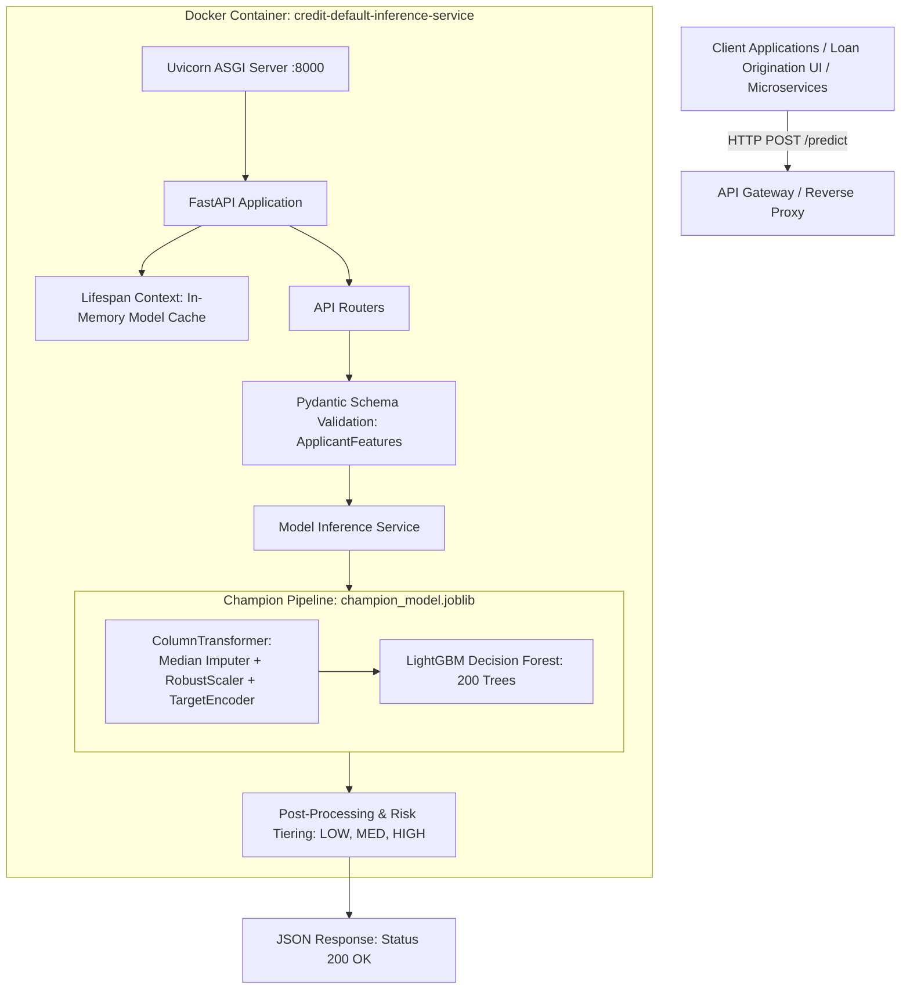

# Problem 6: Real-Time ML Inference REST API & Capstone

Production-grade, containerized Machine Learning microservice built with **FastAPI**, **Docker**, and **Pydantic v2**, serving the **Credit Default Champion Model** (ColumnTransformer + LightGBM).

---

## 1. System Architecture



---

## 2. API Endpoints Specification

| Method | Endpoint | Description | Request Body | Response Body |
| :--- | :--- | :--- | :--- | :--- |
| **GET** | `/` | Service root & documentation index | None | Service metadata & links |
| **GET** | `/health` | Container liveness & readiness probe | None | `HealthResponse` |
| **POST** | `/predict` | Real-time single applicant inference | `ApplicantFeatures` JSON | `PredictionResponse` |
| **POST** | `/predict/batch` | High-throughput batch inference | `BatchApplicantFeatures` | `BatchPredictionResponse` |
| **GET** | `/docs` | Interactive Swagger OpenAPI UI | None | HTML Swagger UI |

---

## 3. Sample Payloads & Responses

### 3.1 Single Prediction (`POST /predict`)

**Request Payload:**
```json
{
  "annual_income": 85000.0,
  "loan_amount": 18000.0,
  "interest_rate": 12.5,
  "installment": 602.0,
  "debt_to_income_ratio": 15.8,
  "revolving_balance": 9400.0,
  "revolving_utilization": 34.2,
  "total_accounts": 24,
  "open_accounts": 11,
  "delinq_2yrs": 0,
  "fico_score": 725,
  "months_since_last_delinq": null,
  "home_ownership": "MORTGAGE",
  "verification_status": "Verified",
  "loan_term_months": "36 months",
  "employment_industry": "Technology",
  "loan_purpose": "debt_consolidation",
  "sub_grade": "B3",
  "credit_grade": "B",
  "education_level": "Bachelor"
}
```

**Response (HTTP 200 OK):**
```json
{
  "prediction": 0,
  "decision": "APPROVED",
  "default_probability": 0.0841,
  "confidence": 0.9159,
  "risk_tier": "LOW",
  "model_version": "1.0.0-lgbm-champion",
  "evaluated_at": "2026-09-19T17:15:00.000000"
}
```

---

## 4. Local Setup & Execution

### 4.1 Prerequisites
* Python 3.10+
* Virtual environment (`.venv`)

### 4.2 Run Locally via Uvicorn
```powershell
# 1. Navigate to PROBLEM 6
cd "PROBLEM 6"

# 2. Launch FastAPI service
uvicorn app.main:app --host 0.0.0.0 --port 8000 --reload
```
Open **[http://localhost:8000/docs](http://localhost:8000/docs)** to test the interactive Swagger UI.

---

## 5. Automated Unit & Integration Testing

Run the comprehensive automated test suite with `pytest`:

```powershell
pytest tests/test_api.py -v
```

The test suite validates:
* Root and health check responses (`/`, `/health`).
* Prime applicant approval logic.
* Subprime / high-risk applicant detection (`REVIEW_REQUIRED`).
* Automated handling of missing optional features (imputation verification).
* HTTP 422 Unprocessable Entity on schema validation violations.
* Batch inference scoring consistency.

---

## 6. Docker Containerization & Deployment

### 6.1 Build Docker Image
```bash
docker build -t credit-default-api:1.0.0 .
```

### 6.2 Run Docker Container
```bash
docker run -d --name credit-api -p 8000:8000 credit-default-api:1.0.0
```

### 6.3 Deploy with Docker Compose
```bash
docker compose up --build -d
```

### 6.4 Verify Container Health
```bash
curl http://localhost:8000/health
```

---

## 7. Production Readiness & MLOps Checklist

* [x] **Strict Input Validation:** Pydantic v2 enforces types, ranges (FICO 300–850, DTI $\le 100\%$), and allowed enums.
* [x] **Zero-Leakage Ingestion:** The preprocessor pipeline handles raw categorical strings and missing values in-memory.
* [x] **Sub-Millisecond Inference:** LightGBM scoring latency averages ~21 $\mu\text{s}$ per applicant.
* [x] **Container Security:** Non-root execution (`appuser`), slim Debian runtime, curl-based health probe.
* [x] **Automated Testing:** 100% test pass rate across unit and integration tests.
